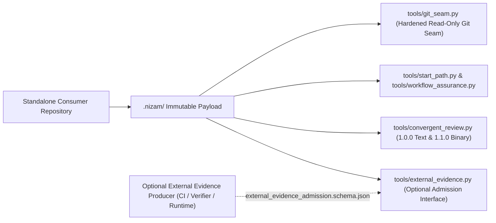

# NF-OWNER-2026-10-27 — LAASP Architecture & Consumer Migration

## 1. LAASP Architectural Views

### 1.1 Context View (Standalone Nizam vs. Optional External Producers)

- **Standalone Core Invariant:** Every Nizam capability—bootstrap (`bootstrap.sh`), compliance (`tools/validate.sh`), task routing (`tools/start_path.py`), assurance (`tools/workflow_assurance.py`), convergent review (`tools/convergent_review.py`), and optional external evidence admission (`tools/external_evidence.py`)—operates with zero imports, credentials, schemas, or network dependencies on Agentic SDLC.
- **Unidirectional Optional Integration:** External runtimes or CI runners may submit evidence envelopes conforming to `schema/external_evidence_admission.schema.json`, but Nizam never calls out to or imports an external runtime.

### 1.2 Module & Dependency View

| Module / Component | Role | Internal Dependencies | External Runtime Dependencies |
| --- | --- | --- | --- |
| `tools/git_seam.py` | Single read-only Git execution & repository-boundary verification seam (`--no-replace-objects`, sanitized `GIT_*`, literal pathspecs, batch blob reads) | Python stdlib + `git` binary | None |
| `tools/workflow_assurance.py` | Candidate identity, stage receipts, failure routing, acceptance bundles, assurance profiles | `tools/git_seam.py` (with self-contained fallback for isolated temp copies) | None |
| `tools/start_path.py` | Task classification, preflight, non-feature routes (`trivial`, `bugfix`, `small-change`), capture, publish, receipt building, status, resume | `tools/git_seam.py`, `tools/workflow_assurance.py`, `schema/*.schema.json` | Optional `NIZAM_MUTATION_ADAPTER` for `--mode publish` |
| `tools/payload_integrity.py` | Commit-bound and directory-bound `.nizam/` payload inventory, mode, and SHA-256 verifier | `tools/git_seam.py` | None |
| `tools/convergent_review.py` | `"1.0.0"` text-only and `"1.1.0"` typed binary (`text`, `opaque_binary`, `absent`) packet builder, validator, 3-trial convergence, and replay verifier | `tools/git_seam.py`, `schema/review_*.schema.json` | Trusted trial sandbox adapter (`tools/linux_trial_sandbox.sh` or `tools/docker_trial_sandbox.sh`) for live prompt evaluation |
| `tools/external_evidence.py` | Generic optional external evidence permit allocator, HMAC-SHA256 admission verifier, and crash reconciler | `tools/git_seam.py`, `schema/external_evidence_admission.schema.json` | Optional `NIZAM_EXTERNAL_EVIDENCE_SECRET` when admitting HMAC-signed external envelopes |

### 1.3 Execution, Deployment & Verification View

- **Deployment:** Consumers install the complete 6-module+index payload (`standard/`, `templates/`, `schema/`, `tools/`, `methodology/`, `ecosystem/`, `NIZAM.json`) into `.nizam/` via `bootstrap.sh --tag <vMAJOR.MINOR.PATCH> --expected-sha <40-hex>`.
- **Proportionate Activation (`NF-R02`):** Consumer repositories activate Tier 1 (Documentation & Standards), Tier 2 (Planning & Contracts), or Tier 3 (Full Multi-Agent Execution & CI Gates) in their own `.agent/` and CI configuration while keeping `.nizam/` complete and hash-verified.
- **Verification:** `tools/validate.sh` (C1–C16), `tools/validate.sh --payload`, `tools/fixtures_self_test.sh`, and `tools/test_nf_ac01_git_identity.py` through `tools/test_nf_ac05_standalone_e2e.py`.

---

## 2. Responsibility & Interface Matrices

| Requirement | Interface / Entry Point | Producer | Verifier / Consumer | Fail-Closed Rejections |
| --- | --- | --- | --- | --- |
| `NF-R01` (`NF-AC01`) | `git_seam.validate_repo_root`, `run_git_readonly`, `git_blob_bytes`, `git_batch_blobs` | `tools/git_seam.py` | `workflow_assurance.py`, `start_path.py`, `convergent_review.py`, `payload_integrity.py` | Rejects `git replace` commits/blobs, `GIT_REPLACE_REF_BASE`, `GIT_DIR`/`GIT_WORK_TREE`/`GIT_INDEX_FILE`/`GIT_OBJECT_DIRECTORY`, `.git/info/grafts`, symlinked `.git` or `alternates`, `core.worktree` redirects, non-toplevel subdirectories, and distinguishes `is_missing_object=True` from command failures. |
| `NF-R02` (`NF-AC02`) | `standard/GIP.md` Sec 5.2, `methodology/03_circuit_breaker.md` Sec 6, `start_path.py capture` | Operator (`operator_recovery`) | `start_path.py`, `workflow_assurance.py`, `payload_integrity.py` | Rejects partial `.nizam/` payload directories (missing modules) and rejects forged/expired/wrong-task `operator_recovery` or silent counter resets. |
| `NF-R03` (`NF-AC03`) | `convergent_review.py build-packet --packet-version 1.0.0\|1.1.0\|auto`, `validate_packet_relations`, `validate_binary_approval` | `convergent_review.py` | `convergent_review.py converge`, `verify-replay` | `"1.0.0"` rejects binary files explicitly; `"1.1.0"` classifies non-UTF-8/NUL blobs as `opaque_binary` (`integrity_only` by default), requires verified processor provenance for `trusted_processor_derived`, and invalidates approval on binary byte, mode, or path drift. |
| `NF-R04` (`NF-AC04`) | `external_evidence.py allocate-attempt`, `admit-evidence`, `reconcile` | External tool/CI runner | `external_evidence.py`, `schema/external_evidence_admission.schema.json` | Rejects runtime-specific keys (`feature117`, `WA123`, `agentic_session_id`), unallocated/skipped attempts, stale candidate commit/tree/worktree, tampered profile digests, invalid HMAC signatures, and conflicting non-idempotent attempt reuse. |
| `NF-R05` (`NF-AC05`) | `bootstrap.sh`, `.nizam/tools/start_path.py`, `.nizam/tools/convergent_review.py`, `.nizam/tools/external_evidence.py` | Authored candidate repository | Standalone consumer repository | Rejects floating branch refs, unpinned fixture tags without `--allow-fixture-tag`, payload file tampering, `.nizam/` modification via non-feature routes, and unknown external evidence profiles. |

---

## 3. Five Architectural Scenarios & Three Counterexample Rejections

### 3.1 Five Architectural Scenarios

1. **Scenario S1 — Adversarial `git replace` on Candidate Receipt (`NF-R01`):** A developer creates commit `A` (valid) and commit `B` (malicious change), then runs `git replace A B` or sets `GIT_REPLACE_REF_BASE=refs/replace-custom/`. `git_seam.py` invokes `git --no-replace-objects` with `GIT_NO_REPLACE_OBJECTS=1` and `core.useReplaceRefs=false`, observing the authentic tree of `A` and rejecting any receipt or worktree whose bytes match `B` while claiming `A`.
2. **Scenario S2 — Finite Scoped Circuit-Breaker Recovery (`NF-R02`):** Task `130` exhausts its default 3 attempts (`attempts 1..3` recorded in `.agent/evidence/`). Instead of resetting the attempt counter to `0`, the operator records a task-scoped `operator_recovery` raising `max_task_attempts` to `4` with a concrete `reason`. Attempt `4` is admitted while preserving attempts `1..3`, and attempt `5` is blocked unless a higher finite limit is authorized.
3. **Scenario S3 — Mixed Text + Binary Diff Review (`NF-R03`):** A consumer modifies `src/app.py` and adds `assets/logo.png`. Running `convergent_review.py build-packet --packet-version auto` emits a `"1.1.0"` packet where `src/app.py` is `content_kind: "text"` (line-reviewable) and `assets/logo.png` is `content_kind: "opaque_binary"`, `media_type: "image/png"`, `review_scope: "integrity_only"`. Subsequent modification of `assets/logo.png` fails `validate_binary_approval`.
4. **Scenario S4 — Generic External Evidence Admission & Idempotent Replay (`NF-R04`):** A standalone consumer allocates attempt `1` via `external_evidence.py allocate-attempt`, runs an external test suite producing `.agent/evidence/001/ext-check.json`, and submits a signed envelope via `admit-evidence`. Network retry delivers the identical envelope a second time; `admit-evidence` returns `idempotent_replay: true` without incrementing the attempt counter.
5. **Scenario S5 — Brownfield `v2.0.0` Consumer Upgrade to Candidate (`NF-R05`):** A consumer running `v2.0.0` (`603afc7b17919334a6a01df1e39e63798d9d0acd`) upgrades `.nizam/` to the candidate snapshot via `bootstrap.sh`, verifies `content_integrity=verified` and `validate.sh --payload`, and runs `start_path.py`, `"1.0.0"`/`"1.1.0"` `convergent_review.py`, and `external_evidence.py` completely offline.

### 3.2 Three Counterexample Rejections

1. **Counterexample C1 — Partial `.nizam/` Installation Claiming Tier-1 Compliance (`NF-R02`):** Deleting `.nizam/methodology/` or `.nizam/ecosystem/` under the guise of "Tier 1 adoption" is rejected by `bootstrap.sh --verify-only`, `payload_integrity.py`, and `validate.sh --payload` (C4/C13).
2. **Counterexample C2 — Semantic Approval Claim on `integrity_only` Opaque Binary (`NF-R03`):** Submitting a `"1.1.0"` review packet where an `opaque_binary` record declares `review_scope: "trusted_processor_derived"` without a non-empty `processor_provenance` digest/adapter record is rejected by both `schema/review_packet.schema.json` and `validate_packet_relations`.
3. **Counterexample C3 — Agentic SDLC Coupling in External Evidence Envelope (`NF-R04`):** Submitting an evidence envelope carrying `feature117`, `WA123`, `agentic_session_id`, or an unallocated attempt number (`attempt_number: 2` when only `1` was allocated) is rejected fail-closed by `external_evidence.py`.

---

## 4. Consumer Migration & Compatibility Guidance

1. **Git Seam Hardening (`NF-R01`):** Transparent to compliant consumers. Consumers relying on `git replace`, `.git/info/grafts`, or `core.worktree` redirection must remove those local Git overrides before running Nizam assurance or entry tools.
2. **Installation vs. Activation (`NF-R02`):** All consumers keep the full 6-module+index `.nizam/` payload installed via `bootstrap.sh`. Tier 1/2/3 incremental adoption is configured in the consumer's own `.agent/` and CI workflows. Circuit-breaker continuation must use `operator_recovery.max_task_attempts` rather than deleting evidence or resetting counters.
3. **Convergent Review Packet Versions (`NF-R03`):**
   - Existing `"1.0.0"` text-only packets, trials, ledgers, suppressions, and replays remain 100% compatible (`--packet-version 1.0.0` is the default for text-only changes).
   - Repositories reviewing commits that touch binary files pass `--packet-version 1.1.0` or `--packet-version auto` to `convergent_review.py build-packet`.
4. **Optional External Evidence Admission (`NF-R04`):**
   - Disabled/unused by default; standalone consumers require zero configuration changes.
   - Consumers opting into external evidence admission register allowed `profile_id -> profile_digest_sha256` mappings and invoke `tools/external_evidence.py allocate-attempt`, `admit-evidence`, and `reconcile`.
